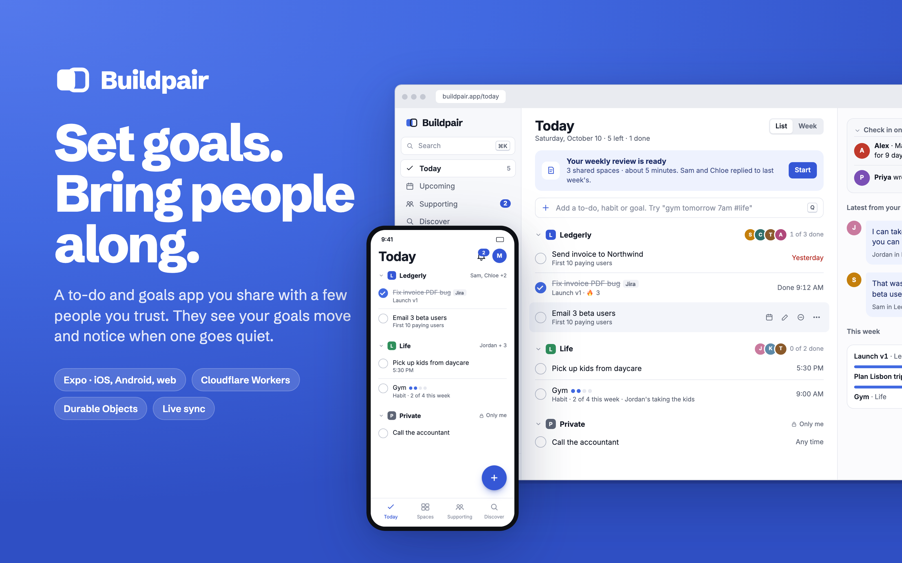

# Buildpair

Buildpair is a to-do and goals app for builders that you share with a few people you trust. They see your goals move, notice when one goes quiet, and tell you how it looks from the outside. One Expo codebase runs on iOS, Android and the web, and the backend runs entirely on Cloudflare.

Live at [buildpair.app](https://buildpair.app) once production is released. Staging runs at [staging.buildpair.app](https://staging.buildpair.app). Code at [github.com/hacka-tron/buildpair](https://github.com/hacka-tron/buildpair).

## Short descriptions

One line. A social to-do and goals app where a few trusted supporters keep your goals moving.

Two sentences. Buildpair is a to-do and goals app for builders that you share with a few people you trust. Your supporters see your goals move, notice when one goes quiet, and talk about it in each space's live chat.

Paragraph. Plenty of apps track to-dos, but working alone on a side project or a startup still feels lonely. Buildpair keeps your goals and to-dos in spaces, and the people you invite to a space watch it move. Finishing something posts a line to the space's chat, supporters react and reply, and when a goal goes quiet only they get a nudge to check in. It runs on iOS, Android and the web from one codebase, with a backend built on Cloudflare Workers and a Durable Object per space so every change syncs live and works offline.

## The problem

Builders such as founders, indie hackers and people shipping side projects usually work alone. Public feeds and maker communities turn into broadcasting with little back and forth, and to-do apps have no sense of anyone watching. Buildpair is built around the idea that accountability comes from a small audience of specific people who are close enough to care and far enough from the work to be honest.

## What it does

- **Spaces.** Everything lives in a space, which is a list plus one chat. Examples are "Ledgerly" for a product, "Life" for family and "Running" for a half marathon. Sharing is set per space, and any single item can stay private inside a shared space.
- **Updates come from the work itself.** Ticking an item posts a line to the chat, small to-dos roll up into one line a day, and supporters react with stacked reactions.
- **Supporters.** People you invite see progress, react, reply and get a quiet nudge when a goal stalls. The goal's owner never sees the nudge, so a check-in reads as a friend reaching out.
- **Invites by link.** Anyone with a space's link can join it, the way group chats work.
- **Offline first.** Changes apply instantly on the device, queue while offline and sync on reconnect with no duplicates.
- **Passwordless sign-in.** People sign in with a 6-digit code sent by email.

Designed and planned next are habits with weekly progress, goals with steps, a Today view across spaces, natural-language adding ("gym tomorrow 7am"), a Supporting tab, Discover for finding supporters, weekly reflections, badges and compliments, and Jira sync.

## How it's built

| Layer | Choice |
|---|---|
| App | Expo SDK 57 and React Native 0.86, one codebase for iOS, Android and web, with Expo Router |
| API | Cloudflare Workers with Hono |
| Real-time core | One Durable Object per space that owns its event log, chat and live sockets, plus one per person for their inbox |
| Data | SQLite inside each Durable Object, D1 for global data, Drizzle for the schema |
| Auth | Better Auth with email codes, sessions shared across subdomains |
| Shared rules | A TypeScript domain package that runs the same rules on the device and on the server |
| Contracts | Zod schemas for every command, event and socket message, with a versioned protocol |
| Email | Resend for sign-in codes, Cloudflare Email Routing for inbound mail |
| Delivery | GitHub Actions with a full preview environment per pull request, automatic staging deploys and approval-gated production releases |

## Engineering highlights

**Each space is its own small database.** The product's unit is the space, so the architecture uses the same unit. A Durable Object per space is the only writer for that space. It numbers every event, stores the log in its own SQLite database and runs the WebSocket connections for everyone in it. That gives strong consistency inside a space without a central database becoming the bottleneck.

**One set of rules on the phone and on the server.** Every change to a space is a command handled by a pure `decide(state, command, actor)` function, and events are applied with `applyEvent`. The app runs the same functions for instant optimistic updates, and the server runs them to make the authoritative decision. The two never disagree about the rules.

**A sync engine built for bad networks.** The app keeps a local copy of each space, a persisted queue of pending commands and a cursor into the event log. Commands carry IDs, so retries are safe. When a socket reconnects the app catches up on any gap in the sequence.

**Privacy enforced on the server.** Items marked "only visible to me" never reach other members. The server filters every event by who is allowed to see it, and each new event type gets a privacy test.

**A pipeline that treats every pull request like production.** Each pull request gets its own API Worker, its own Durable Objects, its own D1 database and a preview web app, then a cleanup job removes them when the pull request closes. Merges deploy to staging automatically. Production deploys only when a release is published and approved, and secrets flow from GitHub environments to the Workers with nothing set by hand.

**Staging locked to invited people.** Staging and previews accept only listed emails. The check sits where every sign-in code is sent and where every session is created, so strangers can neither receive email from the domain nor sign in by any method.

## Quality

- 37 unit and integration tests across the domain rules, the sync engine, the protocol, the landing page and the API. API tests run inside the real Workers runtime.
- Two browser tests run on every pull request. One covers sign-up from the landing page on desktop and mobile. The other has two people sign in, create and join a space, chat live, react and see a completion line appear.
- Lint, type checks, secret scanning and CodeQL run on every push.

## Design

The visual direction is called Margin Notes. A goal is the page, and supporters' notes sit beside it like an editor's notes in the margin. The brand is royal blue with Schibsted Grotesk for the product voice and an italic serif for the people writing in the margin. Every screen supports light and dark modes and follows each platform's conventions.

## Status

The foundations are built and deployed to staging. That covers sign-in, spaces, invites, live chat with reactions, to-dos that post to the chat, offline sync, the landing page and the full CI and deploy pipeline. The remaining screens exist as complete designs for phone and desktop, and they are being built next. Production has not been released yet.

## Images

All images are 2x resolution PNGs.

| File | What it shows | Source |
|---|---|---|
| `thumbnail.png` | Project thumbnail, 1600 × 1000 | Design concepts |
| `social-cover.png` | Social and link preview cover, 1200 × 630 | Design concepts |
| `landing-page.png` | Landing page on desktop (light) and phone (dark) | Live staging site |
| `phone-trio.png` | Today, a space with its chat, and Supporting on phones | Design concepts |
| `desktop-space.png` | A space on desktop with its list, chat and people | Design concept |
| `phone-lineup.png` | Spaces, Discover, a profile and notifications | Design concepts |
| `screens/` | Individual phone, desktop and landing page screens | Mixed, see file names |

Files starting with `landing-` show the live site. The other screens come from the product's design mockups in `docs/design/` and show where the app is heading. When describing the project publicly, call them designs rather than screenshots of the running app until those screens ship.
